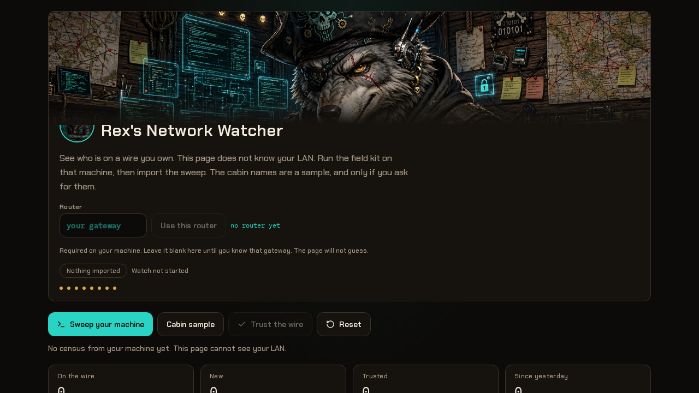

# Rex's Network Watcher

[](https://htmlpreview.github.io/?https://raw.githubusercontent.com/masterxhackerx420-oss/rex-network-watcher/main/docs/index.html)

**Live desk:** [open it](https://htmlpreview.github.io/?https://raw.githubusercontent.com/masterxhackerx420-oss/rex-network-watcher/main/docs/index.html)

The button above is the desk. This repository is the field kit that runs on the machine.

[](https://htmlpreview.github.io/?https://raw.githubusercontent.com/masterxhackerx420-oss/rex-network-watcher/main/docs/index.html)


Defensive census of a network you own.

It ping-sweeps your private IPv4 LAN, reads the ARP table, reverse-resolves hostnames, and stores a baseline on that machine. The next day's run prints only what changed. Nothing is uploaded. There is no port scan and no credential use.

Use it only on a network you are allowed to inventory.

## Your machine, not the cabin

`sweep` reads the private LAN on the computer you run it on. It does not ship a host list, and it will not reuse someone else's gateway. cabin-gw, blackbeard, and wolfsec-phone are not in this tool.

```bash
python3 rex-network-watcher.py sweep
python3 rex-network-watcher.py sweep --json
```

Change the gateway only when this machine should watch a different private /24 you own:

```bash
python3 rex-network-watcher.py router 192.168.1.1
python3 rex-network-watcher.py sweep
```

A saved router that is not on this machine is ignored, and the sweep uses the LAN that is.

## Run

Python 3.9+ and the system `ping` plus `ip` (Linux) or `arp` (macOS). No third-party packages.

```bash
python3 rex-network-watcher.py selftest
python3 rex-network-watcher.py sweep
python3 rex-network-watcher.py accept
python3 rex-network-watcher.py diff
```

`sweep --json` prints a census you can import into the desk. Only private /24 prefixes are swept.

## What the flags mean

- **NEW** — answered, and the MAC is not in the baseline yet
- **OK** — MAC is in the baseline
- **Since yesterday** — new, gone, or a changed IP versus the previous census

`accept` trusts every host in the latest census. Run that once you recognize the wire, then let `diff` be the daily alarm.

## The desk

The live desk is [open it](https://htmlpreview.github.io/?https://raw.githubusercontent.com/masterxhackerx420-oss/rex-network-watcher/main/docs/index.html). A browser cannot ARP a house. Import `sweep --json` from this script when you want your census there. The cabin list is a sample button, not the default. The baseline in the page stays in the browser. This script's baseline stays on the machine.
